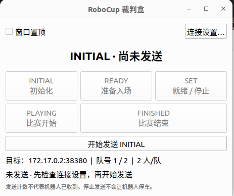
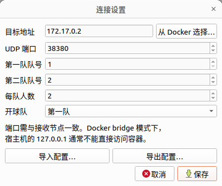

我在运行官方demo时，发现机器人出现了定位失败，不方便控制等问题。我做了一些修改，供大家参考。
2026.11.10 by xrzhu
## 自定义裁判机
Booster studio自带的裁判机是一个全自动的程序，无法中途干预。在debug初期不方便我们测试，所以我先在本地实现了一个裁判机，可以辅助我们测试。

### config修改
把`src/brain/config/config.yaml`中的`team_id`改成1（默认应该是29）
也可以不改，修改裁判机的连接设置为29。总之只需保证机器人端config的设置和裁判机的设置中队伍号一致即可。

## 自动视觉踢球模式
目前机器人支持两种模式：
（1）普通踢球模式：这个实际上是推球，没有踢球
（2）自动视觉模式：有踢球动作
切换模式需要修改`src/brain/config/config.yaml`中`enableAutoVisualKick`的值
true为自动视觉，false为普通踢球模式，默认true

在自动视觉模式下，我的机器人出现了不踢球的情况，经过排查后，发现是视觉踢球接口调用失败：
`src/brain/src/robot_client.cpp`中`RLVisionKick`接口发送：
`{"start": true}`
但当前底层 SDK 要求：
`{"start": true, "version": 0}`
所以将该接口修改为：
```
int RobotClient::RLVisionKick(bool start)

{

booster_interface::msg::BoosterApiReqMsg msg;

msg.api_id = static_cast<int64_t>(booster::robot::b1::LocoApiId::kVisualKick);

// The current locomotion API requires both start and a numeric version.

const booster::robot::b1::VisualKickParameter parameter(

start, booster::robot::b1::VisualKickVersion::kV1);

msg.body = parameter.ToJson().dump();

std::cout << "RobotClient::RLVisionKick called with start=" << (start ? "true" : "false") << std::endl;

return call(msg);

}
```

重新编译，运行，机器人就可以正常踢球了。

## 定位失败问题
经过初步调查，官方提供的视觉检测模型效果不是很好，所以初期我们先直接调用平台提供的定位数据，后续等待视觉问题解决，我们再接入定位算法。

代码修改比较多，请参考[https://github.com/user-rui221/BoosterK1-code]()