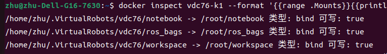
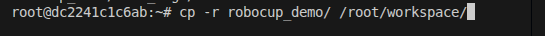
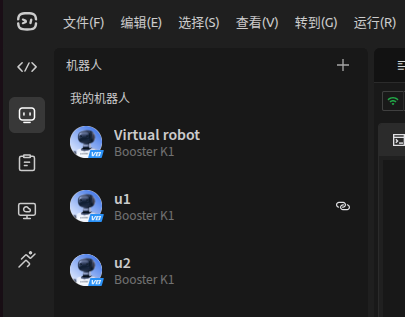
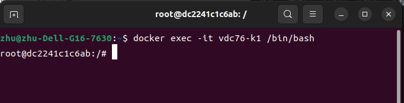
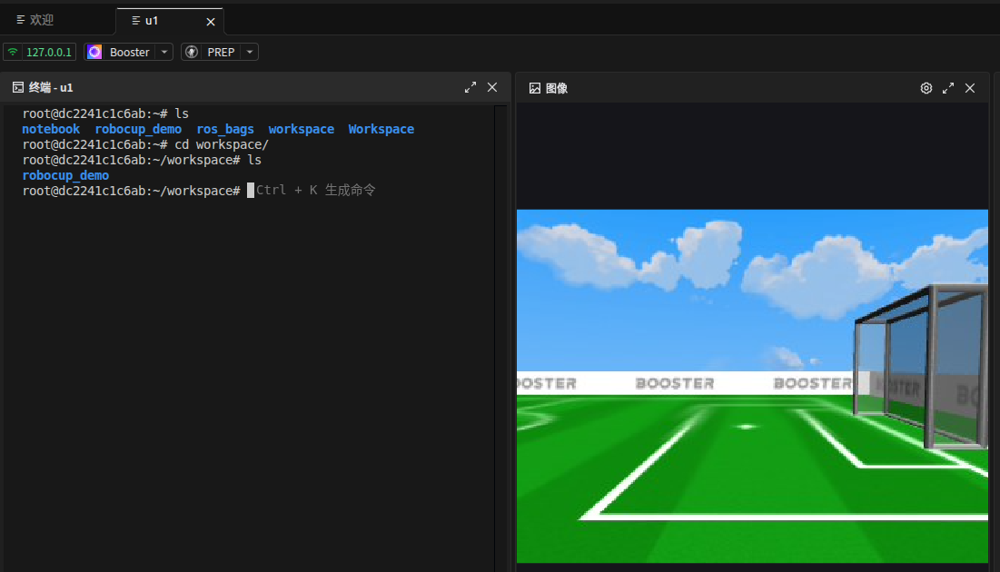

本篇主要叙述创建好容器后，如何建立工作流
2026.11.10 by xrzhu
## 开发流程
机器人现在的代码位于容器中，不方便平时的调试。为了更方便地阅读调试代码，我们把位于容器中的代码挂载到本地，这样之后的工作流就是：
**本地负责阅读debug,容器负责编译和运行。**
### 挂载
1.明确自己机器人的容器名（环境配置的文档有相关说明，这里不再赘述）
2.查看容器的挂载路径：
```bash
docker inspect <容器名称或ID> --format '{{range .Mounts}}{{println .Source "->" .Destination "类型:" .Type "可写:" .RW}}{{end}}'
```
以我电脑上的终端输出为例：



可以发现容器有默认的挂载路径，这里我就将容器中的代码复制放到了`/root/workspace`路径下，



然后查找下本地挂载处是否已经有了`robocup_demo`文件夹（我这里的本地位置是`/home/zhu/.VirtualRobots/vdc76/workspace`）
（复制过来的文件夹可能会上锁，自己查资料解决一下就行。）
**补充：如何进入容器内部？**
（1）首先要启动容器，可以自己手动命令行启动，也可以点击booster studio中的连接机器人

点击`u1`,弹出仿真界面，容器就启动了。
（2）进入容器内部
方法一：在自己电脑终端输入：
```
docker exec -it <容器名称或ID> /bin/bash
```

方法二：Booster studio已经集成了一个终端，可以直接在终端中输入命令


#### 清理
（1）之前在`/root`目录下的`robocup_demo`文件夹根据需要可以保留或者删除
（2）重新编译：（编译一定要在容器中）
`./scripts/build_no_cuda.sh`
编译没问题的话，再
`source install/setup.bash`
就可以正常运行了
### 启动机器人
在容器中进入工作目录：
`cd /root/workspace/robocup_demo`
运行启动脚本，开启核心节点：
`./scripts/sim_start.sh`

接下来进入仿真界面，将机器人切换成`walk`模式。
开启裁判机，就可以运行比赛了。

第一次运行时，机器人可能会出现定位失败等问题，可以自己思考一下，如果要修改代码的话，一定要做好本地git管理和修改说明，也可以参考我之后的文档。